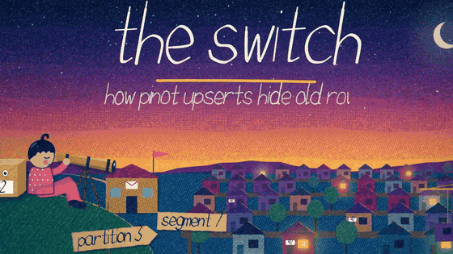
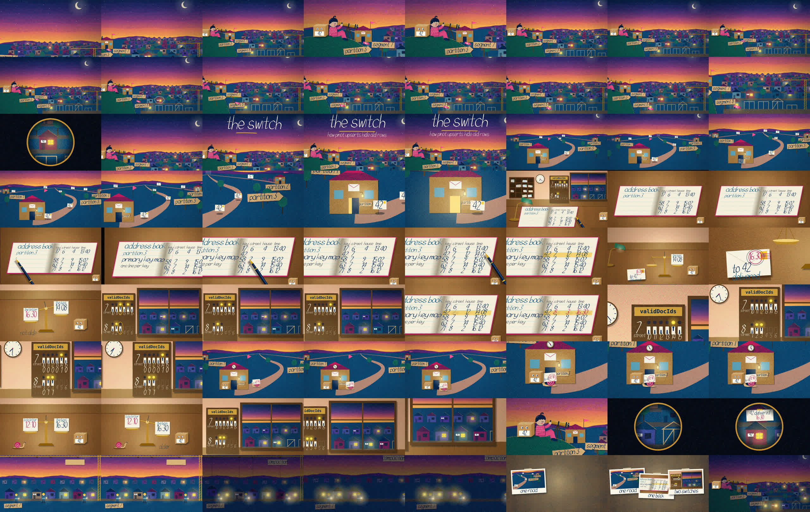
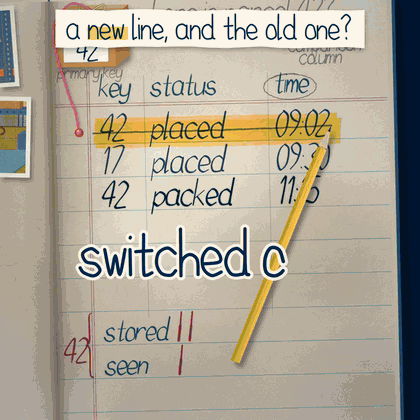

# inkreel

**Give your coding agent a film crew.**

Every frame is drawn by code. Every note of the music is computed. No footage,
no stock art, no samples, no video model. One HTML page, a seed, and a lot of
written-down taste.



*9 seconds of "The switch", a 130 s lesson on how Apache Pinot upserts hide
old rows, made by an agent with inkreel.
[Watch the whole thing with sound](https://github.com/KKcorps/inkreel/releases/download/v0.1.0/lesson60-v8-preview.mp4).*

```bash
npx skills add KKcorps/inkreel
```

Then ask your agent for a film:

> Make a narrated lesson film on how Kafka keeps order inside a partition.

> Make a 40 second film about how a bloom filter says "maybe", in a riso look.

> Here's a clip I love. Pull it apart, then make one about consistent hashing that learns from it.

## A film is a function

```js
window.__frames = 896                  // 37.3 s at 24 fps
window.__render = f => draw(f, seed)   // frame f, drawn the same way every time
```

That's the whole contract. Headless Chrome renders each frame, numpy computes
the score on the same beat grid, and ffmpeg joins them. Same seed, same film.

Because the film is code, your agent can do what it can't do with a video
model. It can look at frame 412, see the label that's off by a word, fix that
one line, and rebuild.

## The hard part isn't drawing. It's taste.

Ask any agent for "an animated explainer" and you get slides that slide.
Getting from there to films people watch to the end took many films and a lot
of notes like "the start feels abrupt", "the ending is abrupt" and "just beats
on every motion". inkreel writes every one of those notes down, so your agent
starts where I ended up.

- **It writes the brief first.** The takeaway and the feeling go on an intent
  card before any code, and the finished MP4 is measured against it.
- **It watches before it draws.** A gallery of 29 code-drawn films people
  loved, and what they share: a thing to follow, a gauge that shows where we
  are, an ending that answers the start. Two of mine that passed every check
  and were still bad are in there too, with why.
- **It sketches three stories, not three styles.** Three different things that
  happen, as finished stills. You pick.
- **It writes the words as one paragraph** before cutting them into lines, so
  the narration sounds like a person explaining, not a stack of captions.
- **It names a thing only after showing it.** The viewer meets a row of light
  switches before they hear "valid doc IDs".
- **It ends, it doesn't stop.** A recap, a payoff that answers the first line,
  and picture and sound fading out together.

## It checks the cut

| check | what it catches |
|---|---|
| `seamcheck.py` | a frame that flashes, a pop off a cut, a jerk inside a move |
| `verify.py` | a film that misses its own brief: length, pace, loudness, clipping |
| `heard.py` | a word the narrator swallowed. Whisper listens and lists every word it didn't hear |
| `wordsync.py` | a picture that doesn't move on the word it's tied to |
| `shiftcheck.py` | a scene timed to a frame instead of the voice. It slides the voice 2 s later and fails any scene that didn't follow |
| `scriptcheck.py` | a term said before the viewer was shown the thing it names |
| `sketchcheck.py` | a sketch that's flat, or a copy of a film it learned from |

Then it tells you to watch it anyway. A film can pass every number and still
be bad, and the gallery has two that did.

## The receipts

"The switch", the lesson-film worked example:

- 130 s and 3,110 frames, rendered in about 5 minutes across 12 Chromes
- 287 of 287 words heard
- 29 of 29 tied words moving on their word
- -14.0 LUFS, YouTube's loudness target
- 0.16 cuts a second. The first cut ran 0.36, and was "too fast paced"
- eight versions, and its README says what each note changed and what is
  still weak



## Two skills

- **`code-film`** makes any short film: an explainer, a music video, a story,
  an ad, a visual poem. It works in any hand-made look (riso, paper collage,
  ink, watercolour, pixel, blueprint, sand). Its worked example is
  *Parcel 42's day* (37 s), in `skills/code-film/assets/examples/parcel42-day/`:
  a riso world and an ink ledger cut together in one film.
  [Watch it with sound](https://github.com/KKcorps/inkreel/releases/download/v0.1.0/parcel42-day.mp4).

  

- **`lesson-film`** makes a narrated lesson for YouTube that teaches one
  technical mechanism in one to two minutes. The voice sets the clock, the
  picture changes on the word that names it, and the music plays in the gaps.
  Its worked example is *The switch*, in
  `skills/lesson-film/examples/parcel42-lesson/`. It builds on `code-film`, so
  install both.

Read the examples for the method, not the look. A copied example is how every
film starts to look like one film.

## Install

```bash
npx skills add KKcorps/inkreel
```

In Claude Code you can also install it as a plugin:

```
/plugin marketplace add KKcorps/inkreel
/plugin install inkreel@inkreel
```

Or copy both folders from `skills/` into your agent's skills folder
(`~/.claude/skills/`, `~/.codex/skills/` or `~/.agents/skills/`). They must sit
next to each other.

## Setup

`code-film` needs Chrome (or a `CHROME` path), Node 22+, ffmpeg and Python 3
with numpy and Pillow. `bash skills/code-film/assets/doctor.sh` checks them and
says how to fix anything missing.

`lesson-film` also needs [uv](https://docs.astral.sh/uv/) and an ffmpeg with
`loudnorm`. `bash skills/lesson-film/assets/setup.sh` builds a Python 3.12 venv
with [Kokoro](https://huggingface.co/hexgrad/Kokoro-82M) for the voice and
faster-whisper for the hearing check. Both run on your machine. No API key, and
the voice is yours to publish.

## Where it came from

I make technical explainers. These two skills are what's left after a lot of
films, with Claude and Codex doing the drawing and me giving the notes.
`skills/code-film/reference/taste.md` is those notes. It's one person's taste,
a place to start. Where you want something else, you win.

If you make something with it, I'd love to see it:
[@cto_junior](https://x.com/cto_junior).

## Credits

- The print finish (flat fills with a clipped texture, and the shapes of
  `wob`, `crayon`, `hatch`, `grain`, `dotScreen` and `scribble`) comes from
  the `hand-drawn-canvas-animation` skill by
  [alesha-pro](https://github.com/alesha-pro/tools), MIT. See
  [THIRD_PARTY.md](THIRD_PARTY.md).
- The films in the gallery belong to their makers and are linked, not copied.
  Kevin Ngo's flipbooks are the ones that started this.

## License

MIT. See [LICENSE](LICENSE).
