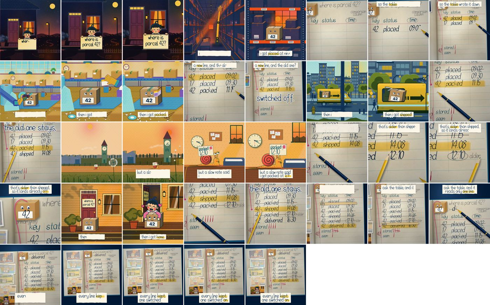

# Parcel 42's day

The one film this skill has made that its first reviewer called perfect. This is
its fifth version, with the words rewritten as one voice. It is
a 37 second explainer of Pinot upserts. Read it for how it was built. Do not
copy its story or its look, because a copied example is how the next piece
comes out the same. `reference/gallery.md` says why it works.

## What happens

A kid at a dusk porch asks "where is parcel 42?". The film follows the parcel's
day: a box on a warehouse shelf wakes up as parcel 42, gets packed, rides a van
through the city, and a snail carries a late "packed 12:10" update to the
clerk's desk. At the doorstep the kid hugs it. Between the scenes, a clerk's
ledger writes each new status as a new line, strikes the older line in pencil,
and moves a thread from the parcel to its live line. The late line is struck
the moment it lands. The ledger's left page is an album: each moment is pinned
as a postcard and fades when its row is struck.

## How it is built

- `assemble.py` copies `../../engine.html` and edits it as text: 24 fps, the
  parcel's colours on the anchor's two fixed drums, no demo worlds, this film's
  acts. Run `python3 assemble.py` to write `film.html`.
- `acts.js` is the act list. Lived acts draw through the riso press. Ledger acts
  use the engine's `raw` hook, so a second renderer draws them straight onto
  the sheet. `SECOND_SHOT` declares each scene's cut to a closer framing.
- `ledger.js` is the second renderer, in its own scope so its names never meet
  the engine's. It runs on the film's clock through `LEDGER.init(filmAt)` and
  puts its own cuts in `EXTRA_CUTS`.
- `film_core.js` holds `parcel42()`, the character every scene shares. It
  prints on the anchor drums, which no act re-inks, so it is the same kraft
  brown with indigo eyes in every world.
- `scenes/` holds one file per pair of lived scenes. Three helpers drew them in
  parallel, each filling `LIVED.<act>` and touching nothing else.
- `film.score.py` is the composed score: a motif that asks, an answer, a tick
  tock for the ledger, a sleepy phrase with one wrong note for the snail, and
  the motif resolving on the plate where "delivered" is written. Six accents,
  only at the story's turns.
- `film.chain.txt` is the film's words as one paragraph, in one voice: the kid
  asks, and parcel 42 answers ("then i got packed", "then i got shipped",
  "the old one stays, just switched off."), until the snail breaks the pattern. The words in
  `film_core.js` are cut from it and drawn through the engine's `OVERLAYS`: a
  running line on a paper strip, each word on its sixteenth, and a giant
  refrain at the turns. `build.sh` hands the paragraph to the gate.
- `film.intent.md` is the card it was verified against.

Build it with `bash ../../build.sh film.html out.mp4` after `assemble.py`. It
takes about 8 minutes and about 2 GB of frames.
